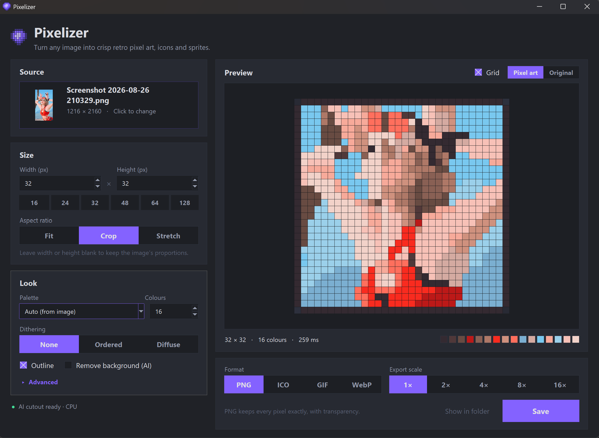
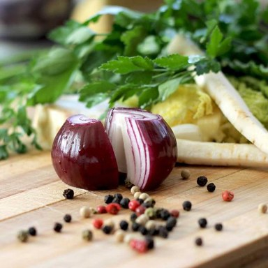
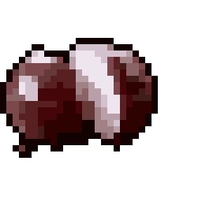
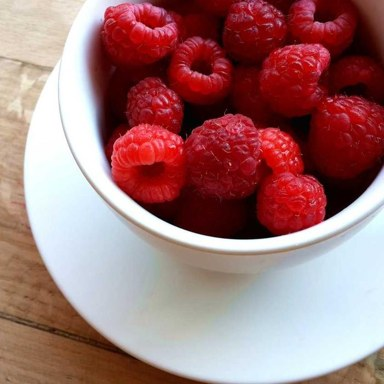
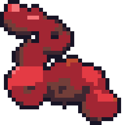
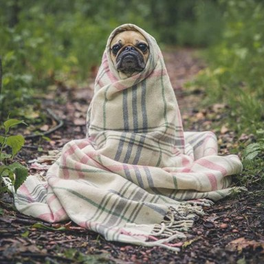
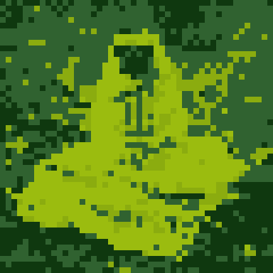
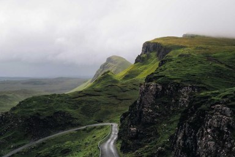
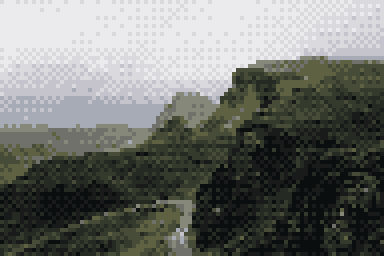
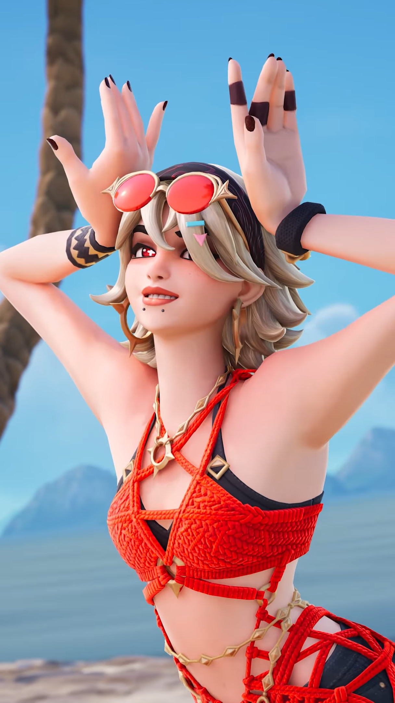

# Pixelizer

Turn any image into crisp retro pixel art: app icons, sprites, avatars and Game Boy-style scenes. You pick the exact output size (16×16, 32×32, 96×64, anything), and an optional, lightweight AI cutout turns photos into transparent icons.



## Examples

| Original | Pixel art | Command |
|---|---|---|
|  |  | `-s 32 --remove-bg --outline -c 12` |
|  |  | `-s 32 --remove-bg --outline --palette endesga-32` |
|  |  | `-s 48 --palette game-boy -d ordered --contrast 1.3` |
|  |  | `-s 96x64 --fit crop -c 12 -d ordered` |
|  |  | `-s 32 --fit crop --outline --scale 8` |

The results are shown enlarged with `--scale`; the real files are 32×32, 48×48 and 96×64. The first four example photos come from [Unsplash](https://unsplash.com/license) via picsum.photos.

## Requirements

- Python 3.9+
- `pip install -r requirements.txt` (Pillow, NumPy, and onnxruntime for the optional AI cutout)
- Optional: the AI background-removal model (4.6 MB):

```
python setup_tools.py
```

This downloads [U²-Net-p](https://github.com/xuebinqin/U-2-Net) into `models/`. It runs on the CPU in a fraction of a second. To run it on the GPU instead, install `onnxruntime-directml` (Windows, any DirectX 12 GPU: NVIDIA, AMD or Intel) or `onnxruntime-gpu` (NVIDIA CUDA) in place of `onnxruntime`. The app shows which device it's using.

## Desktop app

Double-click **`pixelizer_gui.pyw`** (or run `python pixelizer_gui.pyw`). Pick an image (or paste one with **Ctrl+V**), set the size and look, and the preview updates live. Then choose a format and hit **Save** (**Ctrl+S**).

- **Size**: type any width × height or click a preset (16 to 128). Leave one side blank to keep the proportions. *Fit* pads, *Crop* fills, *Stretch* distorts.
- **Look**: an automatic palette with N colours, or a classic one (PICO-8, Sweetie 16, Endesga 32, Commodore 64, Game Boy, CGA, 1-bit). You can also add dithering, a 1px outline, and AI background removal.
- **Advanced**: downscale method, contrast, saturation, background fill, trimming and stray-pixel cleanup.
- **Preview**: toggle a pixel grid, or flip to the original to compare.
- **Export**: PNG, ICO (every size from 16 to 256 px with hard edges, ready for Windows shortcuts), GIF or lossless WebP, enlarged 1× to 16×.

If the AI model isn't installed yet, the app shows an **Install AI model** button.

### Build a standalone .exe

```
pip install pyinstaller
python build_exe.py
```

This creates `dist/Pixelizer.exe`, a single file you can put anywhere and double-click, with no Python needed. The AI model is looked for in a `models/` folder next to the exe, so either copy `models/` over or click **Install AI model** in the app.

## Command line

```
python pixelize.py photo.jpg                          # -> photo_32x32.png
python pixelize.py photo.jpg -s 64x48 --fit crop      # exact size, cropped to fill
python pixelize.py photo.jpg -s 64x                   # 64 wide, height keeps the aspect
python pixelize.py photo.jpg -p 8                     # every 8x8 source block becomes 1 pixel
python pixelize.py logo.png -s 32 -o logo.ico         # multi-size Windows icon
python pixelize.py cat.jpg -s 48 --remove-bg --outline --scale 8
```

| Option | Meaning |
|---|---|
| `-o, --output` | Output file; extension picks the format (`.png .ico .gif .webp .bmp`) |
| `-s, --size` | `N` (square), `WxH`, `Wx` or `xH` (keep aspect). Default 32 |
| `-p, --pixel-size` | Instead of `--size`: source pixels per output pixel |
| `--fit` | `fit` (pad), `crop` or `stretch` when the aspect ratio differs |
| `--palette` | `auto`, `pico-8`, `sweetie-16`, `endesga-32`, `c64`, `game-boy`, `cga`, `1-bit` |
| `-c, --colors` | Colours for the auto palette (default 16) |
| `-d, --dither` | `none`, `ordered` (Bayer) or `floyd` (Floyd–Steinberg) |
| `-m, --method` | `smart` (default), `average` or `nearest` |
| `--outline` | 1px dark outline around the shape |
| `--remove-bg` | AI background removal |
| `--contrast`, `--saturation` | Boost before pixelizing (1 = unchanged) |
| `--background` | Fill transparency with a hex colour |
| `--scale` | Enlarge the saved file N× with hard pixel edges |
| `--no-trim`, `--no-cleanup` | Keep transparent borders / stray single pixels |

## How it works

Shrinking a photo with a normal resize gives a blurry, muddy thumbnail, not pixel art. Pixelizer does this instead:

1. **Palette**: colours are clustered with k-means in [OKLab](https://bottosson.github.io/posts/oklab/), a perceptual colour space, so the chosen colours look distinct to the eye. Alternatively, a fixed retro palette is used.
2. **Smart downscale**: each output pixel looks at the block of source pixels it covers. It takes the colour that *most* of them belong to, not the average, so edges stay sharp and never turn into in-between blends.
3. **Clean-up**: lone stray pixels are replaced by their neighbours' colour, and small specks left by the background cutout are dropped.
4. **Finish**: optional dithering, a 1px outline in the palette's darkest colour, then export with nearest-neighbour scaling so pixels stay square.

### Why there's no Vulkan

The heavy work happens at the *output* resolution (such as 32×32 or 128×128), so a whole render takes well under a second on the CPU. A GPU path would add a large dependency for no visible gain. The one part that benefits from a GPU is the AI model, and onnxruntime's DirectML/CUDA builds already handle that (see Requirements).
